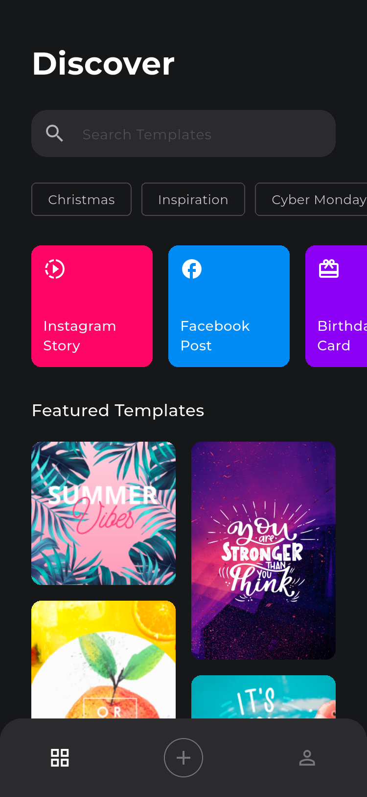
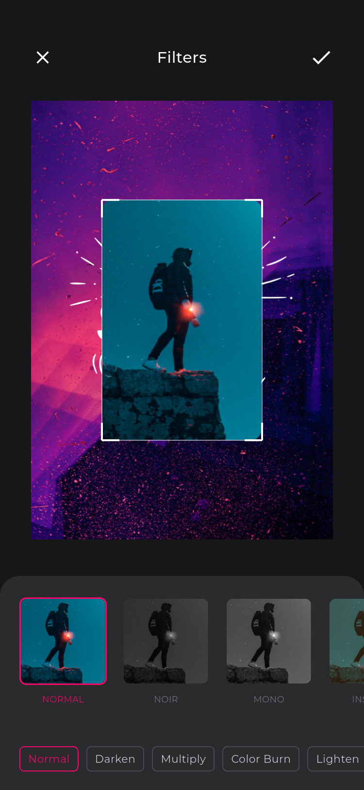
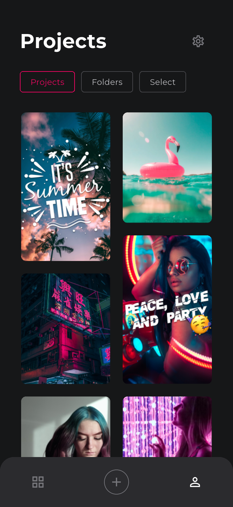
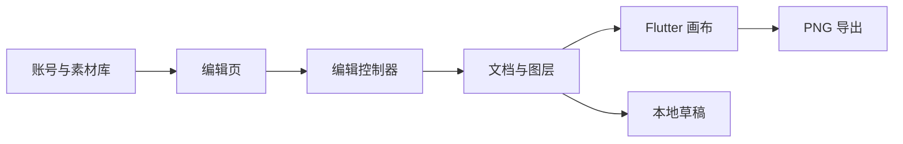

# Mage Photo Edit

Mage 是一个基于 Pixso 设计稿实现的 Flutter 照片与海报编辑器。通过 MCP 读取了「Mage Photo Edit App」的 50 个界面状态和「Components」的 8 组组件。应用保留设计稿的英文文案、深色主题和玫红强调色，模板和示例照片来自 Pixso 导出的素材。

| 模板发现 | 滤镜编辑 | 我的项目 |
| --- | --- | --- |
|  |  |  |

[50 个界面截图与 Pixso 节点索引](docs/SCREENS.md)

## 运行

需要 Flutter 3.47.7、Dart 3.13.5 和已配置的 Android SDK。复用现有模拟器时，先用 `flutter devices` 确认设备 ID。

```powershell
flutter pub get
flutter run -d emulator-5554
```

在登录页输入任意格式有效的邮箱和至少 6 位字符的密码，进入 Discover。可以选择模板，或点底部的加号新建空白项目。编辑后点右上角导出按钮保存草稿或生成 PNG。Android 10 及以上的 PNG 保存在相册的 `Pictures/Mage` 中。

## 项目结构

```text
lib/
  main.dart                        应用启动与本地草稿加载
  app.dart                         主题、导航与 50 个参考状态入口
  data/project_store.dart          项目、文件夹、语言偏好的本地存储
  ui/kit.dart                      搜索、标签、标题栏、按钮与选框
  features/
    account/account_screen.dart    登录、注册、设置、语言与订阅
    library/library_screen.dart    模板、素材库、项目与文件夹
    editor/
      editor_model.dart            文档、图层、编辑历史
      editor_screen.dart           编辑交互与工具面板
      editor_canvas.dart           画布合成、变换与预览
  services/                        Android、iOS 与 Web 的 PNG 保存实现
assets/                            Pixso 素材与字体许可证
docs/                              截图、设计参考和界面索引
test/                              编辑历史与草稿持久化测试
tool/capture_screens.ps1            通过 ADB 批量采集调试版截图
```



编辑控制器保存项目状态和撤销记录。相同的工具面板复用滑杆、色板和选项组件，工具值变化会立即更新画布。项目存储保存文档和文件夹归属，重新打开草稿可继续编辑。导出复用画布渲染并隐藏编辑选框和透明背景的棋盘格。

## 验证与截图

```powershell
flutter analyze
flutter test --concurrency=1
flutter build apk --debug --target-platform android-x64
adb -s emulator-5554 install -r build/app/outputs/flutter-apk/app-debug.apk
./tool/capture_screens.ps1 -Device emulator-5554
```

截图在已有的 BlueStacks Android 11 模拟器上以 375 × 812 的逻辑视口采集。脚本用调试版入口访问每个参考状态，其中部分是编辑面板或筛选状态。常规应用入口是登录页。

本次验证检查了 50 个页面的运行截图，并在模拟器上确认 PNG 写入相册以及透明背景的 Alpha 通道。可直接安装 [Android x86_64 调试 APK](release/mage-photo-edit-debug.apk)。

## 当前范围

本版提供本地图片导入、图层变换与管理、文字排版、形状和贴图、滤镜、画布裁剪、背景、阴影、透明度、草稿和 PNG 导出。部分画稿细节使用 Flutter 图标、可用字体和原生键盘近似实现。

登录和订阅为本地演示，素材库使用内置素材。语言页保存选择，界面继续使用设计稿的英文。验证环境为 Android，工程保留 iOS 和 Web 入口。

